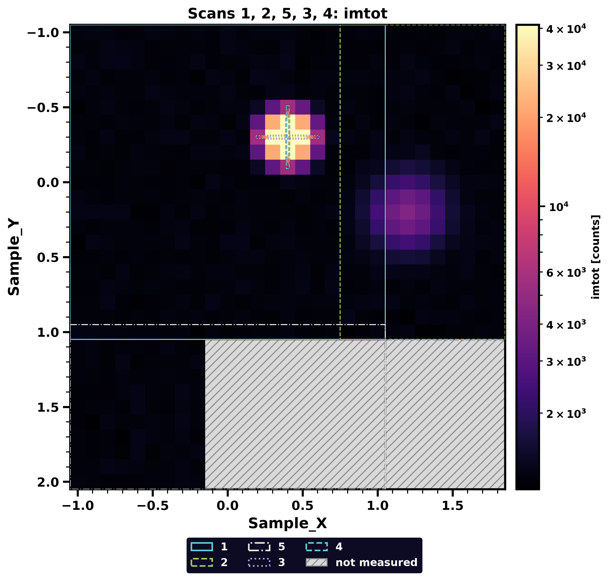

# Mesh maps

`splotter mesh` draws one counter over two motors, from one scan or several.

```
splotter mesh demo.spec 1 --counter imroi3 --log
splotter mesh demo.spec 1 2 5 3 4 --log --save map.png
```

For each scan it prints the command, the mean of the counter and where it peaks:

```
Scan 1: mesh sy -1 1 20 sx -1 1 20  0.5
  mean imtot = 2103, max imtot = 97699 at Sample_X = 0.4, Sample_Y = -0.3
```



## Reading the map

- **Scans:** `mesh` scans, and `ascan` or `dscan` line scans of one of the two motors. A line scan
  sits at the position of the other motor, read from the `#P` lines of the scan.
- **Color:** all scans share one scale, so their colors compare. It ends at 10 times the mean of the
  scans, not at the maximum, so that a few hot points do not leave the rest in one color. Points above
  it take the brightest color, so the printed maximum or `--vmax` tells how bright they are.
- **Gray hatching:** nothing was measured there. This includes the missing points of an aborted scan.
- **Overlaps:** the run given later is drawn on top. Change the order to see the other one.
- **Outlines:** with several scans, each has its own color and line style, named in the legend.
- **Axes:** the horizontal axis is `Sample_X` and the vertical one is `Sample_Y`, with smaller numbers
  at the top. Equal lengths on both axes are the same distance. A mesh of other motors puts its outer
  motor, the second of the command, across and its inner one down.

## Options

| Option | Effect |
|---|---|
| `--counter NAME` | The counter to draw (default `imtot`) |
| `--log` | Log color scale; zero counts take its lowest color, so they do not look unmeasured |
| `--vmax VALUE` | Top of the color scale (default: 10 times the mean) |
| `--x NAME`, `--y NAME` | The motors of the axes (default `Sample_X`, `Sample_Y` if the scans move either, else the motors of the first mesh) |
| `--save FILE` | Write the figure to a file instead of opening a window |
| `--wait` | Keep the window in this terminal until it is closed |

Names match without regard to case, spaces and underscores, and a mnemonic as typed in SPEC
(`sx`, `imroi1`) finds its name where the file has `#o` and `#j` rows. Files before 2015 usually
have no `imtot`, so give a `--counter`; the error message lists the columns of the scan.

The map takes the motors and ranges from the scan command: `mesh` and `dmesh` as a grid, and
`ascan`, `dscan` and `lup` of one of the two motors as a line at the start position of the other.

## Looking at one cell

`splotter probe` draws the same map as `splotter mesh`, with the same arguments, in a window you can
point at. The command returns at once, and what a click prints still comes to this terminal, so
closing the terminal closes the window on Windows (`--wait` keeps it in the foreground):

```
splotter probe demo.spec 1 2 5 3 4 --log
splotter probe demo.spec 1 --counter imroi3 --show Sample_X Sample_Y imroi3 immax
```

- **Hover** over a cell: the panel at the left of the map lists the scan, the point number, the time,
  `Sample_X` and `Sample_Y` as measured at that point, and the counters. The point number is the one
  `splotter info demo.spec 1 301` takes. The panel stays where it is, so the window never changes
  shape.
- **Click** a cell: it stays outlined in cyan, the panel keeps listing it while the mouse is off the
  map, and the terminal prints every motor and counter recorded at that point, as `splotter info`
  does for a point.
- Where scans overlap, the panel lists the one drawn on top, the run given later.
- Cells that were not measured show nothing.

| Option | Effect |
|---|---|
| `--counter NAME` | The counter that gives the colors (default `imtot`) |
| `--show NAME ...` | What the panel lists besides the two axes (default: every counter) |
| `--x NAME`, `--y NAME` | The motors of the axes, as for `splotter mesh` |
| `--log`, `--vmax VALUE` | As for `splotter mesh`, as is the color scale of several scans |

It has no `--save`, as a picture holds no mouse; use `splotter mesh --save` for that. The legend of
several scans is at the bottom left, under the panel.

## Limits

- Line scans have no width of their own and are drawn with square cells. A short step can be too thin
  to read on a large map, so use the printed maximum or `splotter info` for its values.
- Cell positions start from the first measured point and use the step of the command. Motor positions
  that wander during a scan are not followed.
- Other scan types, such as `a2scan`, are refused.
